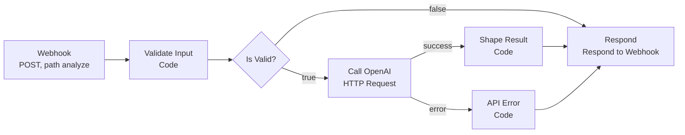

# Text to OpenAI API (n8n webhook workflow)

A small n8n workflow that turns a webhook into a text-analysis API. A caller sends JSON with some text. The workflow checks the request, asks OpenAI for a one-sentence summary and a category, and always answers with clean JSON and the right HTTP status code.


*The n8n canvas: seven nodes, three Code nodes, and one Respond node that every path ends at.*

## What a caller sees

Send a POST request to the webhook path `analyze` with a JSON body:

```json
{ "text": "The delivery was late and nobody called me." }
```

A successful reply has this shape (the values below are an illustration, not a recorded run):

```json
{
  "status": "success",
  "result": {
    "summary": "The customer is unhappy about a late delivery with no call.",
    "category": "complaint"
  }
}
```

Every other outcome returns an error in the same style, so the caller never receives a raw n8n error page.

| Situation | HTTP status | `error.code` |
| --- | --- | --- |
| Body is missing, not an object, or is an array | 400 | `invalid_input` |
| The `text` field is missing | 400 | `missing_field` |
| The `text` field is not a string | 400 | `wrong_type` |
| The `text` field is empty or only spaces | 400 | `empty_text` |
| The `text` field is longer than 4000 characters | 400 | `text_too_long` |
| The OpenAI call fails after its retry | 502 | `api_error` |
| OpenAI answers, but the answer cannot be read as JSON | 502 | `bad_ai_output` |

## How it works



1. **Webhook.** Accepts POST requests on the path `analyze` and waits for the Respond node before it answers.
2. **Validate Input** (Code). Checks the five rules in the table above and trims the text. Its script is in [`code/validate-input.js`](code/validate-input.js).
3. **Is Valid?** (IF). Sends valid requests on to OpenAI. Invalid requests skip the AI call and go straight to Respond with their 400 error.
4. **Call OpenAI** (HTTP Request). Posts to the OpenAI chat completions endpoint with the `gpt-4o-mini` model and `json_object` output. It uses an OpenAI credential stored in n8n, a 30-second timeout, and up to 2 tries. If it still fails, its error output continues to API Error instead of stopping the workflow.
5. **Shape Result** (Code). Reads the AI answer, parses it, and wraps it as a 200 reply. If the answer cannot be parsed, it returns the 502 `bad_ai_output` error instead. Its script is in [`code/shape-result.js`](code/shape-result.js).
6. **API Error** (Code). Builds the 502 `api_error` reply. Its script is in [`code/api-error.js`](code/api-error.js).
7. **Respond** (Respond to Webhook). Sends the JSON body and the HTTP status code that the earlier node prepared.

### The prompt

The system message sent to OpenAI is:

```text
Read the text from the user. Reply only with JSON in this exact shape: {"summary": "one short sentence", "category": "question, complaint, praise, or other"}
```

## Controls built in

| Control | Why it matters |
| --- | --- |
| Input is checked before any AI call | Bad requests are rejected cheaply and clearly, and they never reach OpenAI. |
| Text is limited to 4000 characters | Keeps requests and costs bounded. |
| The API key lives in n8n credentials | The exported workflow contains no key and no credential reference. |
| 30-second timeout and up to 2 tries | A slow or failing AI service does not leave the caller waiting. |
| Error output is wired to a handler | A failed AI call becomes a readable 502 reply, not a raw error. |
| AI output is forced to JSON, then parsed | An unreadable answer is caught and reported instead of being passed on. |
| One Respond node for every path | Every outcome has an explicit status code and the same reply style. |

## Testing

The three Code nodes are plain JavaScript, so they can be tested outside n8n. [`tests/code-nodes.test.js`](tests/code-nodes.test.js) runs each script with sample inputs, including the edge cases for the 4000-character limit. It needs only Node.js:

```bash
node tests/code-nodes.test.js
```

All 12 checks pass. The OpenAI call is not part of these tests, because it needs a real API credential.

## Use the workflow

1. In n8n, choose **Import from file** and select [`workflow/text-to-openai-api.json`](workflow/text-to-openai-api.json).
2. Open the **Call OpenAI** node and select your own OpenAI credential.
3. The workflow is exported as inactive. Test it with the test URL, then activate it when you are ready to use the production URL.

## Tools

n8n (Webhook, Code, IF, HTTP Request, and Respond to Webhook nodes), OpenAI API, JavaScript.

## About the data

No API keys, customer data, or real messages appear in this repository. The sample text in the tests is invented.

## More from me

See my other builds at [frankdespi.github.io](https://frankdespi.github.io) and on my [GitHub profile](https://github.com/Frankdespi).
